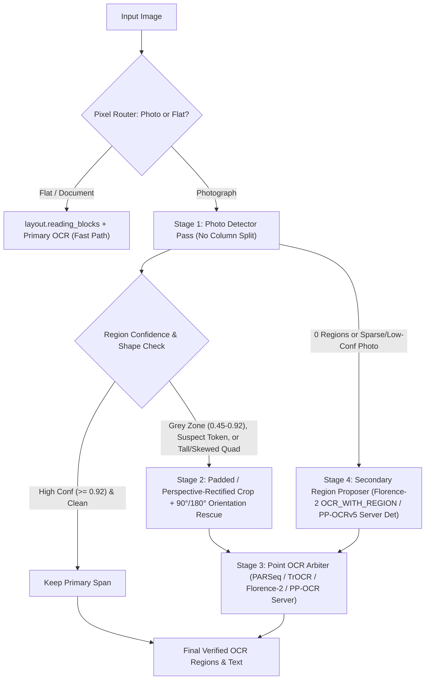

# OCR on Photos (TextVQA) Improvement Plan

*Drafted: 2026-10-20*
*Status: Plan only — nothing in this document has been modified in `src/` yet. Each gate waits for a go-ahead.*
*Reviewed 2026-10-21 (Opus 5.5): **read Section 0 first; it supersedes Sections 2–5 wherever they conflict.** Nothing was run for the review except DuckDB queries over cached result files.*

---

## 0. Review Outcome (2026-10-21) — Supersedes Where It Conflicts

Every claim was checked against the live code ([`ppocr_engine.py`](../src/fusion_vision_mcp/ppocr_engine.py),
[`analysis.py`](../src/fusion_vision_mcp/analysis.py) `_read_page` / `_looks_sideways` / `_read_upright` / `ocr_pages`,
[`routing.py`](../src/fusion_vision_mcp/routing.py) `choose_count_backend`), RapidOCR 3.9.2's shipped `config.yaml` in the
server `.venv`, and VisionBench's cached results (`replacement_gate1_tune.json`, the per-item
`replacement_gate1_ocr_*_tune.jsonl` rows, `ppocr_det_sweep.json`, `textvqa_annotations_extended.json`). The
diagnosis in Section 2 holds up well: the 37 tune misses and every quoted example match the cached rows and
questions, and the TrOCR scoring bug is real. The main problems are in the measurement, not the ideas: the
TextVQA "confirm" half is not held out, the scorer rewards emitting more text, and the document controls cannot
see the photo branch. Those are fixable before anything runs (0.3).

### 0.1 Verdict per item

| Item | Verdict | Why / what changes |
| :--- | :--- | :--- |
| **1.1** skip `reading_blocks` on photos | **Keep as a measured variant, not a default. Check first whether it can matter.** | No evidence yet that `reading_blocks` splits TextVQA photos at all. And the router sends JPEG screenshots and photographed or scanned documents down the photo path (0.2), which is exactly where column splitting earns its keep. Step A1 (0.8) counts how often `reading_blocks` returns more than one zone on the 184 TextVQA images and on `lines` / `p11_text`. If it rarely splits TextVQA photos, the variant cannot gain and is dropped. |
| **1.2** keep quads; padded / rectified crops | **Accept. This is the shared plumbing for every crop track.** | Verified: `spans()` collapses RapidOCR's 4-point box to an axis-aligned one. Gate R (2026-10-15) showed why padded crops must go to the **recognizer only** (RapidOCR `use_det=False`), never back through the detector: tight crops through the full pipeline lost 71.6 → 54.5%. Pad sizes (15% / 10% / 6 px) are a starting point fixed before Gate 0, not tuned on TextVQA. |
| **1.3** per-box 90°/270° and 180° rescue | **Accept the per-box opposite-turn re-read; re-scope the 180° part.** | RapidOCR already runs a 0°/180° line classifier on every box (`Global.use_cls: true`, `cls_thresh 0.9`), and it already turns crops with h/w ≥ 1.5 a quarter turn, but only one way. So a tall box gets one read and never the opposite turn: that is a real gap. A box-level 180° re-read duplicates the classifier for boxes that were detected. `#72` (upside-down board game) has to be diagnosed first: if its region was never boxed it is a detector miss (Bucket C), and only a page-level 180° pass could help. That pass belongs to the blur plan's Step 2B (0.6). `#196 ROCKSTAR` may be letters stacked vertically rather than rotated text; no rotation fixes that. |
| **1.4** de-stutter (`SKSKOL` → `SKOL`), split joined words | **Reject the string-rewrite rule; keep "the arbiter supplies the reading".** | A prefix-repeat rule fitted to one tune item is the same kind of text rewriting that failed twice before: the Sprint 20 dictionary filter, and Gate B, where OCR rewrites overwrote correct words (2,810 → 2,800 hits). If an arbiter reads `SKOL` on the padded crop, that already covers it. |
| **2a** PARSeq (docTR) on crops | **Accept as a candidate.** | docTR's PARSeq is trained mostly on documents. Its 4 tune hits that PP-OCRv6 missed came from the whole docTR FAST+PARSeq pipeline, detector included (0.2). The ms timings in the table are estimates, not measurements. |
| **2a′** PARSeq, original scene-text weights (`baudm/parseq`, Apache-2.0) | **Add (new).** | These weights are trained on real scene-text sets, so they are likely stronger on photo crops than docTR's. **Contamination check first:** that training data includes TextOCR, which is built on TextVQA's own images. Gate 0 must confirm none of the scored images are in its training split. |
| **2b** TrOCR-base-str, pad masking fixed | **Accept as a candidate, with two blockers carried over.** | Bug verified: `replacement_gate1.py` averages transition scores over every generated position, post-EOS `<pad>` included. TextVQA goes 37.0% at floor 0.0 → 14.1% at 0.05 and stays flat to 0.55, the signature of near-zero confidences. Blockers: (1) the licence gap already flagged in `detector_ocr_replacement_plan.md` (no licence on the weight card, pickle-only `.bin`); (2) gate 0 measured 3.7 s median / 55 s max on docTR's word boxes, so the number of crops per image must be capped. |
| **2c** Florence-2-large `<OCR>` on crops | **Accept as a candidate; zero new weights.** | The model is resident and runs in bf16 since 2026-10-21. The 300–500 ms figure is unmeasured. Florence-2's OCR head is the one that invented text on `sample.jpg`, so on a crop it is a reader that needs corroboration, never a sole source. |
| **2d** `Windows.Media.Ocr` | **Accept, and add it to Gate 0. The plan's Gate 0 list left it out.** | Untried, as `sam3_expansion_plan.md` noted. Three facts shape it: the WinRT API returns **no confidence** per word or line, so it can only act through agreement rules; it is Windows-only while CI runs Ubuntu, so it would be optional with a fallback; and it needs WinRT Python bindings (a new dependency). Test it twice: on crops, and as a whole-photo engine with its own detector, since that is the only Bucket C angle at zero download. |
| **2e** Moondream2 crop transcription | **Add (new) as a low-prior candidate.** | Zero new weights, and the blur plan proposes it too. Low prior: it paraphrases (documented), and Gate R found `query_image(region)` flat (79.0 → 80.3). Cheap to include in the same pass. |
| **2f** EasyOCR recognizer on crops | **Add (new) as a zero-download corroborator.** | Installed and non-Chinese. Its 37.5% on whole photos was mostly lost at detection; its recognizer on boxes PP-OCR has already found is untested. Its confidences are the calibrated ones `structured_analysis` already relies on. |
| **Arbitration rule** | **Accept the principle; simplify the numbers.** | The rule has 7 thresholds (0.45 / 0.75 / 0.80 / 0.82 / 0.88 / 0.90 / 0.92) for 92 tune items, and confidences from different recognizers are not on one scale. Fix one rule shape before Gate 0: *replace when arbiter ≥ X and primary < Y; rescue a grey-zone span only on agreement of two readers*. Pick X and Y from at most a 3×3 grid, calibrated on `rendered` and `lines`, where the true text is known, not on TextVQA. **Replace, never append:** emitting both readings raises recall under this scorer for free (0.3b) and gives the user duplicate text. If an alternative reading is kept, it goes in `detail=true` only. Also: RapidOCR drops every span under 0.5 internally (`Global.text_score: 0.5`), so the 0.45–0.5 part of the grey zone is only reachable by lowering that setting too. |
| **3A** Florence-2 `<OCR_WITH_REGION>` proposer on sparse photos | **Accept as a candidate; latency is the risk.** | One more Florence-2 call per triggered photo, against a 5 s cap where PP-OCR alone is already at a 2.5 s median. Trigger only when the primary pass finds ≤ 2 regions, and report how often that fires. Florence-2-large-ft (0.5) parks behind this: only worth trying if 3A shows the proposer idea works. |
| **3B** docTR FAST union | **Keep as a candidate; the +4.3 is an oracle at a setting that fails the controls.** | Verified by query: 64.1% is the per-item best of the two engines, i.e. counting a hit when either one hits. It is not a pipeline. It holds only at docTR floors ≤ 0.55, where docTR alone leaves 1 of 4 fixtures and 41% of p11 text-free images non-empty; a plain union there drops p11 text-free empty from 92.2% to **54.9%**. At docTR floor 0.9 (fixtures 4/4) the oracle is 62.0% (+2.2, 2 items), with union-empty 80.4%. One of the 4 docTR-only hits (`#19`) is a counting question ("how many price tags" → `4`) hit by a stray digit. Since PP-OCR missed these regions, "two-model agreement" has to come from docTR plus a third reader. It also needs torch and `opencv-python` on the OCR path (0.2). |
| **4 / C1** PP-OCRv5 server detector, photos only | **Keep as the Track 4 candidate. Its costs were left out; restore them.** | `ppocr_det_sweep.json` `hybrid_server_photos_box_0.4`: TextVQA 58.5 → 62.0, text questions 61.9 → 65.2, text-free empty, **but** sourced lines 76.2 → 75.2, rendered 97.5 → 96.7, and median **2.51 → 4.5 s**. That already reaches the 5 s cap before any Track 1–3 stage is added, and `caption` pays the same time through `read_text`. It was measured on all 200 TextVQA images, so it has no held-out number. `CLAUDE.md` recorded it as "a trade, not a gain". The `limit_side_len 1024` "+2.5" was measured at box_thresh 0.5 (55.0 → 57.5; 1280 fell to 54.0), and with `limit_type: min` it is a minimum short side, i.e. upscaling. It is the "larger side length" `CLAUDE.md` lists as rejected, so it may be retried only photo-routed, at 0.4, and named as a re-test. |
| **4 / C2** PP-OCR server recognizer on crops | **Feasibility smoke first; likely invalid as written.** | `CLAUDE.md`: in rapidocr 3.9 only the PP-OCRv6 English recognizer is a valid English combination, and the multilingual Chinese/English recognizers drop the spaces between English words ("Thisisasingle…"). Smoke check: the combination loads, and a two-word English crop keeps its space. If either fails, C2 is out. |
| **4 / C3** Qwen2.5-VL-3B crop reader | **Keep only as the last fallback, and only with the user's explicit OK (0.7).** | The QwenVisionMCP exception covers spot-checks only, not a shipped model. C4-3b's Gemma 3 4B on CPU took about 42 s per caption, so even short crop reads at 3B scale are unlikely to fit 5 s. The plan's own ordering (non-Chinese first) puts PaliGemma 2 ahead of it (0.5). |
| **Gates 0–2** | **Restructure (0.3).** | Fresh confirm set, a precision guard, a JPEG document control, and rules counted in items. |

### 0.2 Corrections of fact (verified 2026-10-21)

- **"Documents and screenshots take the fast path with zero regression": not true.** The router tests pixels
  (under 10 unique colours per 1,000 px, not greyscale with tonal range), so most **JPEG** screenshots, scans and
  phone photos of documents take the photo path (`CLAUDE.md`, gate F). Phase 14's rendered pages are lossless PNGs
  and route flat, so the `rendered` control **cannot see a photo-branch change at all**. The hybrid's
  rendered-page drop to 96.7% suggests some do route photo; Step A1 counts it.
- **RapidOCR already filters at 0.5** (`Global.text_score`), runs the 180° line classifier (`use_cls: true`),
  and turns h/w ≥ 1.5 crops one way. `limit_side_len 736` uses `limit_type: min`: it upscales a short side
  below 736, it does not cap large images. The blur plan's B3 ("downscaling 1920×1080 by 2–2.7×") rests on the
  opposite reading and should be re-checked there.
- **Bucket counts 9 / 11 / 17 cannot be re-derived.** The diagnostic's output is not saved anywhere in
  VisionBench. The examples check out, but several "VQA-only" candidates may in fact be written in the image
  (`#106` / `#125` "usa", `#63` "face", `#144` "england", `#168` "baking soda"). Gate 0 must save its per-item
  bucket table; TextOCR boxes (0.5) make the split exact.
- **"PARSeq already hit 4 tune items"**: those hits are docTR FAST+PARSeq end to end (detector included), and one
  of them is the counting question `#19`.
- **"Policy updated 2026-10-20"**: unconfirmed (0.7).
- Verified correct: tune baselines (textvqa 59.8, rendered 97.5, lines 73.0, p11_text 76.8, p11_blur 37.4,
  p11_textfree 92.2, fixtures 4/4); full-200 58.5% / 61.9%; shipped engine Florence-2-large; docTR FAST+PARSeq
  alone 44.6% on the tune items.

### 0.3 Measurement problems that change the gates

**a. The TextVQA confirm half is not held out.** All 200 questions (184 images) were used to choose
PP-OCRv6 over EasyOCR (`ocr_param_sweep.py`), `box_thresh 0.4` and the rejected detector variants
(`ppocr_det_sweep.py`), and C1 itself. The sprint R tune/confirm split came after. **Gate 2 needs fresh
TextVQA questions:** draw about 300 from TextVQA val, excluding the 184 images in use (Open Images, CC BY 2.0;
the answers ship with the dataset, so Claude builds it, no worker). Keep the 108 old confirm items as a
secondary report. At 1.1 points per item on 92 tune items, ~300 fresh questions are also what give a
+3-point rule a CI that can clear zero.

**b. The scorer rewards more text.** `ocr_score_item` counts a hit when **any** of the 10 annotator answers
appears in the OCR text. That includes outlier answers (`#29` "leo", `#63` "august", `#173` "7") and single
characters (`#185` "a", `#136` "d"/"i"/"b"), and it has no precision term. Every candidate that adds spans (grey-zone
rescue, union, appended readings) gains on this metric for free. Report three numbers side by side, with the
variants fixed now: (1) any-answer (comparable to the history); (2) answers given by ≥ 3 annotators (the VQA
convention); (3) any-answer with answers of 2+ characters. Add a **precision guard** from the sets with known text: on
`rendered` (JPEG copies, below) and `lines`, the share of output regions that sit on a real line (the phase 14
measure that went 96.4 → 99.3%) must not drop by more than 1 point.

**c. A document control for the photo branch.** Add `rendered_jpeg`: the 26 tune and 34 confirm Phase 14 pages
re-saved as JPEG q85 (routed photo, checked by the router at build time). The line truth is unchanged, so it is a
free control. The `lines` set (sourced real images) also mostly takes the photo path.

**d. Rules counted in items.** On 92 items, "+3.0 points" is 3 items, and ~12 configurations are being compared,
so the best tune score is biased upwards. Gate 0's advance rule: **net ≥ +4 items, at most 1 item that went from
hit to miss**, `lines` and `rendered_jpeg` no worse than −1 point, and the controls held.

**e. `caption` inherits OCR latency.** `read_text` runs `ocr_pages` on every caption. Report the median and
p90 OCR seconds per photo, and state the added caption time next to any OCR gain.

**f. Same-recognizer control (new arm 2-0).** Re-read the padded or rectified crops with **PP-OCRv6's own
recognizer** (`use_det=False`). Without this arm, a gain from better crops cannot be told apart from a gain from a
better recognizer. If 2-0 captures most of the gain, no new model is needed.

### 0.4 What the plan gets right and should keep

The bucket framing (VQA-only / recognizer / detector) is the right decomposition. Bucket A is out of `ocr`'s reach
by design: those questions belong to the `query_image` work, and the plan should not count them as an OCR
target. Gating every new stage behind cheap measurements, keeping the 0.75 floor for single uncorroborated
reads, and running everything in VisionBench before any `src/` change all match how this project works.

### 0.5 Other OCR / TextVQA ideas in the project, consolidated

| Idea | Source | Status | Verdict here |
| :--- | :--- | :--- | :--- |
| `Windows.Media.Ocr` | `sam3_expansion_plan.md` | Untried | Gate 0 arm 2d (crops + whole photo) |
| **TextOCR** word boxes for TextVQA images (Meta, CC BY 4.0) | new | — | Use for diagnosis: was the answer region boxed? It turns Buckets B/C into a measurement, and gives a verbatim per-line metric on photos. Also the contamination list for 2a′. |
| Fresh TextVQA val questions | new | — | Required for Gate 2 (0.3a) |
| PARSeq scene-text weights | new | — | Gate 0 arm 2a′ |
| EasyOCR recognizer as corroborator | new | Installed | Gate 0 arm 2f |
| Florence-2-large-ft `<OCR_WITH_REGION>` | `model_variants_and_loras.md` §3.1 | Untested for OCR (lost the caption bake-off at 36.9%) | Park behind 3A. A second Florence copy is ~1.5 GB resident unless swapped. |
| PP-OCR server recognition (`_server_rec`) | `model_variants_and_loras.md` §3.7 | Untested | = C2; feasibility smoke first |
| TrOCR-small-printed for digit / punctuation confusion | `model_variants_and_loras.md` §3.7 | Untested | Printed-text model; TextVQA is scene text. Optional arm on numeric spans only (`#117` "91" read as "19.1"), after the TrOCR licence question is settled. |
| `ocr(region=…)` with a wider pad | Gate R, `CLAUDE.md` 2026-10-15 | Tight crop lost 71.6 → 54.5%; a wider pad needs fresh region questions | Separate, caller-driven track that reuses 1.2's padding and recognizer-only path. Scored on region questions, not TextVQA. Run after 1.2 exists. |
| PaliGemma 2 mix 3B `ocr` prompt as a photo reader | `detector_ocr_replacement_plan.md` | Downloaded; **parked by the user 2026-10-15** (too big for the gain, ~12 GB fp32, ~6 s/call) | Listed for the user's decision only. It is the non-Chinese VLM that would come before C3. |
| docTR fine-tune on scene text | `model_variants_and_loras.md` roadmap #3 | Deferred | Waits for the user's "good" bar (fine-tunes come after it) |
| PP-OCRv5 server detector photo-only; larger side length | `CLAUDE.md`, `ppocr_det_sweep.py` | Measured on all 200; not shipped | = C1 and a Track 1 re-test |
| CLAHE / contrast retry | `Caption_Improvement_Plan.md` 3A (attributed to this plan, which never proposed it) | Untested | Owned by the blur plan's Step 1B; report its effect on TextVQA too |
| Bucket A (VQA questions); PaliGemma for `query_image` | `model_variants_and_loras.md` roadmap #1 | — | Out of scope: `query_image` track |
| Tables, handwriting, multilingual | `frontier_capability_gaps.md` ideas 1, 7, 8 | Ideas | Out of scope for TextVQA |
| Whole-engine replacement (docTR, TrOCR-large) | Sprint R | Lost (54.3 vs 67.8); TrOCR-large too slow | Not reopened |

### 0.6 Overlap with `ocr_blur_improvement_plan.md`

Both plans independently propose quad preservation, recognizer-only crop re-reads, per-box rotation, 180°
rescue, grey-zone rescue and the same arbiters (Florence-2, Moondream2, PARSeq, TrOCR). Build that once as one
VisionBench module (`ocr_crop_reread.py`, say). Run both plans' Gate 0 arms in **one CPU pass** over the union of
their sets and report them separately; this follows the no-wasted-runs rule. Ownership: **this plan** owns photo
crop rescue, arbiters and region proposers. **The blur plan** owns the sharpness gate, restoration and the page-level
orientation fixes (`_looks_sideways`, 180° page pass, deskew). Per-box rotation is shared. A change that ships from
either plan has to hold the other plan's sets as controls.

### 0.7 Policy

The standing rule in memory is **no Chinese-developed models**, plus **no threshold sweeps or detector-specific
heuristics on PP-OCRv6 while it awaits replacement** (2026-10-08), with per-case exceptions from the user. The
plan's "2026-10-20 exception" is not recorded anywhere I can see, and the caption plan's review flagged the same
line as unconfirmed. Until the user confirms it:
- **Track 4 (C1–C3) stays written but does not run.**
- Track 1 and the arbitration rule must stay **engine-portable**: thresholds kept per engine in one table (not
  constants scattered through `analysis.py`), and quad / padding / rotation code that does not care which
  recognizer is behind it. The grey-zone band and `text_score` change are PP-OCR tuning in the strict sense; the user
  decides whether they fall under the 2026-10-08 rule.

### 0.8 Revised order (each step waits for the user's go-ahead)

Nothing here runs while the user's timed job is on the CPU.

1. **A1, free checks (Sonnet 5.5, new session + handoff, ~10 min CPU, pure numpy).** Router decision and
   `reading_blocks` zone count on the 184 TextVQA images, `lines`, `p11_text` and the JPEG copies of the rendered
   pages. Settles 1.1 and 0.3c.
2. **A2, fresh set build (Opus 5.5 designs; Sonnet 5.5 builds).** About 300 TextVQA val questions not on the 184
   images, plus TextOCR boxes for all images; `rendered_jpeg`; scorer variants (0.3b). Rules for Gates 0–2 are
   committed in the script docstrings **before** any scored run.
3. **A3, diagnostic (Sonnet 5.5, ~5 min CPU).** One PP-OCRv6 pass over the 92 tune items with `text_score` 0,
   saving raw quads and scores. Bucket table via TextOCR overlap, saved to `results/`.
4. **Gate 0, shared with the blur plan (Sonnet 5.5 runs; Opus 5.5 reviews).** Arms: 1.1 (if A1 allows), 1.2+2-0,
   per-box turn, 2a, 2a′, 2b, 2c, 2d, 2e, 2f, 3A, 3B. Then Track 4 only if no non-Chinese arm passes (0.10).
   Advance rule as in 0.3d.
5. **Gate 1 (Sonnet 5.5).** Section 4's suite, plus `rendered_jpeg`, the precision guard and the three scorer
   variants.
6. **Gate 2, run once (Sonnet 5.5 runs; Opus 5.5 verifies).** On the **fresh** set. Ship rule: any-answer gain ≥ +3.0 with
   paired CI lower bound > 0, **and** the ≥ 3-annotator variant not negative, all controls held, median OCR ≤ 5.0 s.
   The "or full-200 ≥ 62.5%" alternative in Section 4 is dropped: it lets tune data into the ship decision.

### 0.10 User decisions (2026-10-21) — these override 0.7 and 0.8 where they differ

1. **Chinese models:** allowed **only if no non-Chinese solution meets the project's performance and
   effectiveness goals**. Track 4 therefore runs **after** the non-Chinese arms and only if none of them passes
   Gate 0's rule (0.3d). If any does, Track 4 is not run, under the no-wasted-runs rule. Reading of the same
   answer for tuning: PP-OCRv6 is the shipped engine with no non-Chinese replacement that meets the goals (sprint
   R), so engine-portable tuning on it (grey-zone band, `text_score`, photo-routed detector settings) is in scope.
   The user may correct this reading.
2. **Fresh TextVQA set and TextOCR download:** approved, as long as they don't conflict with the user's CHAIR
   performance run. Build only when that run is not using the CPU.
3. **`Windows.Media.Ocr`:** "maybe". The server is cross-platform today: CI installs it and runs the full
   pytest suite on Ubuntu 24.04 on every push; the README lists macOS (untested); the only Windows-specific
   code (`idle.py`'s working-set trim) is guarded. This would be the first OS-dependent behaviour, so it stays a
   Gate 0 arm for information. It ships only if it beats every cross-platform arm by a clear margin (rule fixed
   before Gate 0: ≥ +3 items on tune over the best cross-platform arm), and then as an optional extra whose
   per-OS difference is documented. Apple's Vision framework would be the macOS analogue; not proposed.
4. **TrOCR:** keep. User ruling: downloadable weights with no licence stated count as usable. The blocker in 0.1
   (2b) is cleared; the latency cap on crops per image stays.
5. **PaliGemma 2:** stays parked. Fine to use in principle, but too big for a CPU/system-memory server: ~6 GB
   bf16, ~6 s per call, over the 5 s OCR cap on its own, and paid again by every `caption` through `read_text`.
   It is not a Gate 0 arm. It is revisited only as an opt-in slow mode (like `caption(deep)`), and only if the
   user asks.

**Worker handoffs (written 2026-10-21, VisionBench `worker_handoff/`):**
- `RESEARCH_OCR_SCENE_TEXT.md`: the candidate survey plus six factual questions (PARSeq / docTR / TrOCR training
  data, `Windows.Media.Ocr` from Python, TextOCR and TextVQA download facts). Can run any time; no images, no CPU
  here.
- `ROUND22_PLAN.md`: about 300 fresh TextVQA val photos. Stage A is "where would you look" boxes without the
  answers (for the wider-pad `ocr(region=)` track); stage B is "is the answer written" for questions TextOCR can't
  match. It waits for the reviewer's build (step A2), which waits for the CHAIR run.

### 0.11 What the research report changes (reviewed 2026-10-22)

The worker's report is VisionBench `worker_handoff/RESEARCH_OCR_SCENE_TEXT_REPORT.md`. Spot checks: PARSeq's
`Datasets.md` lists TextOCR and OpenVINO's Open Images text among the real training data, as the report says. The
SmolVLM-500M card confirms Apache-2.0 and The Cauldron + Docmatix, but its benchmark figures are an image, so the
TextVQA 63.6 / 68.1 are unverified. Two sources could not be fetched: PyPI blocks automated fetches, and the
TextOCR download page renders with JavaScript. Checked locally by query: TextVQA val has 5,000 questions on 3,166
images, and **all 184 of our current TextVQA images are val images**.

**Contamination, the main finding.** PARSeq's released weights (`baudm/parseq`, `-tiny`, `-patch16-224`) trained on
**TextOCR train and val**. TextOCR val covers 3,153 of the 3,166 TextVQA val images, which includes our 184 and every
image round 22 can draw. TextVQA test has no public answers. So **PARSeq cannot be scored fairly on any TextVQA
image we can use.** MAERec / Union14M (list 2) has the same problem. Changes:
- Arm 2a′ (PARSeq original) is **scored on the non-TextVQA sets only**: `lines`, `p11_text`, `p11_blur`, and the
  round 18 / 20 text images (Commons, not Open Images). Its TextVQA figure is reported, but only as a contaminated
  upper bound.
- Its ship decision needs its own primary metric, decided before Gate 0: key phrases on the round 18 + 20 text
  images, plus `lines`. That set must be checked for Open Images files first, since OpenVINO's text annotations
  also cover Open Images.
- Round 22 is unchanged for every other arm. ROUND22's reviewer note already says PARSeq can't be scored there.

**Arms added or changed:**
- **2b-small: `microsoft/trocr-small-printed`** (62M, `transformers`, no licence stated, which the user accepts).
  No TextOCR or TextVQA in its training. A cheap, clean arm for the digit/price confusions (`#117` "19.1"); it
  replaces the "TrOCR-small-printed" line in 0.5. `trocr-base-printed` and the `-stage1` checkpoints are not added:
  printed and pretraining weights, larger, same domain.
- **2g: SmolVLM-256M / -500M Instruct** (Hugging Face, Apache-2.0). A VLM crop reader, and a candidate whole-image
  reader for sparse photos. Trained on The Cauldron, which includes TextVQA. Same guard as every generative reader:
  corroboration only, never a sole source on a crop. **Split check done (2026-10-22, `RESEARCH_OCR_SPLITS_REPORT.md`):**
  The Cauldron's `textvqa` and `textcaps` subsets are TextVQA **train only** (21,953 images, 34,602 questions,
  matching train exactly; every Cauldron config is a single `train` split, re-checked on the datasets server).
  Docmatix is PDFs only, and the extra SmolVLM data has no TextVQA, TextOCR or Open Images. So **SmolVLM can be scored
  on our val images.** One low risk remains: The Cauldron's `localized_narratives` (train) includes Open Images
  photos, and TextVQA's train and val images both come from Open Images' train set, so some of our images may have
  been narrated (spoken descriptions, not transcriptions). Check that overlap by image ID only if SmolVLM wins Gate
  0. The published TextVQA val scores (VQA metric) are **50.2% (256M) and 60.2% (500M)**, per the technical report's
  Table 1 as the worker quotes it; I did not re-read the table. They replace the 63.6 / 68.1 in the first report.
  That is a lower prior than it first looked: as a whole-image answerer it is well below Moondream2. It stays an arm
  as a crop reader.
- **3C: CRAFT as a second region proposer**, with no new download. It is EasyOCR's detector, already installed.
  Boxes that don't overlap PP-OCR's are read by the best arbiter. EasyOCR's 37.5% end to end does not settle this:
  that figure includes EasyOCR's recognizer.
- **Not added:** ViTSTR and TRBA (synthetic-only, 82–84% on the union benchmark, and docTR's ViTSTR already lost),
  Donut and Nougat (document and academic-PDF models, no scene text), and Felix92's multilingual PARSeq (synthetic,
  docTR family). The reasons are recorded so they aren't re-proposed.

**`Windows.Media.Ocr`, now settled enough to schedule.** `winrt-Windows.Media.Ocr` 3.2.1 (pywinrt, maintained) has
cp313 and cp314 Windows wheels (the report's PyPI reading; not re-fetched here). There is **no confidence anywhere
in the API**. Max dimension is 10,000 px, and `TextAngle` reports rotation. macOS's equivalent (Vision via `pyobjc`)
does give confidences; Linux has no OS engine. So it stays an information-only arm under 0.10's rule: ship only with
a clear margin, as an optional Windows extra.

**LFM2.5-VL-3B (Liquid AI, US) as a sparse-photo reader.** The report points to the caption chat's
`caption_lfm_gguf.py`: Q8_0 GGUF on `llama-server`, 18 threads, 2.9–3.0 s median per caption, 8.9–15.6 GB peak
memory, `confirm.passed: false` for captions. It returns text with 0–1000 boxes in one call. Two cautions before it
becomes an arm: (1) about 97 generated tokens/s from a 3B model is fast for CPU, so confirm that `llama-server` ran
with no GPU offload (recent llama.cpp builds offload by default when a GPU backend is present); (2) 9–16 GB resident
is the same size class the user called too big for PaliGemma (0.10.5). LFM2.5 also has a $10M-revenue licence cap.
**User's call** whether a 3B GGUF fits the "lightweight" server; until then it is not an arm. The 450M variant is
out: its own card says it is not suited to fine-grained OCR.

**Track 4 (only if every non-Chinese arm fails, per 0.10):** per the splits report, GOT-OCR2.0 (StepFun, 0.6B) has
no TextVQA or TextOCR in its training data (LAION-2B / Wukong scene text with PaddleOCR pseudo-labels, Common Crawl
PDFs), so it is scorable; the first report's "includes TextVQA" was wrong. InternVL2-1B lists TextVQA, TextOCR and
TextCaps with **no split stated**, so treat it as contaminated: if ever needed, score it on non-TextVQA sets only,
as with PARSeq. MAERec is contaminated. PP-OCRv4 English recognizer: a C2
alternative, smoke-checked the same way.

**A policy question surfaced by the report: who counts as the developer of Microsoft Research Asia's models?** The
earlier counting survey (`RESEARCH_COUNT_DETECTORS_REPORT.md`) rejected Kosmos-2 as Chinese-developed because MSRA is
in Beijing. TrOCR's authors are largely MSRA too, but the weights are released by Microsoft (US) under
`microsoft/unilm`, and this report lists TrOCR as US. The handoff rule was "the organisation that released the
weights", which reads as Microsoft for both. **The user should settle it once**: if MSRA counts as Chinese, TrOCR
(2b, 2b-small) moves to the fallback list, and Kosmos-2.5 joins it.

**Other small corrections to the report (no effect on the plan):** Moondream2 was not tested on crop
transcription in Gate R (`query_image(region)` was); CRAFT is already shipped inside EasyOCR; ABINet (USTC) and
DeepSeek-VL belong in list 2 rather than "Rejected" / "Too large"; the docTR training-data answer (FUNSD / CORD /
SROIE plus synthetic French vocabulary) cites a PR and source files, not a training card, so treat it as
"mostly documents, details unconfirmed".

**Build facts for A2 (round 22):** TextVQA val JSON is already on disk (`VisionBench/scratch/sources/`); TextOCR
val JSON is 38 MB (CC BY 4.0), and train (267 MB) isn't needed. Images: the 6.6 GB train+val zip is not needed;
download per image from the Open Images mirror by `image_id`, as the existing 184 were (licences from Open Images
metadata, cached in `oi_train_licenses_cache.json`; the questions carry no licence field).

### 0.12 User decisions (2026-10-22)

1. **Microsoft Research Asia models are not Chinese-developed.** TrOCR (2b, 2b-small) stays a first-priority arm.
   Kosmos-2.5 (Microsoft, 1.3B) is no longer barred by origin; it stays out on size, under "Too large".
2. **LFM2.5-VL-3B is already adopted for FusionVisionMCP** (the caption work is integrating it now). For this plan
   that makes it **a resident model, like Florence-2 and Moondream2**: zero new weights, so the size objection in
   0.11 no longer applies. Arms:
   - **3D: LFM2.5-VL-3B as the sparse-photo spotter.** One call on photos where the primary pass finds ≤ 2 regions.
     It returns text with 0–1000 boxes. Every LFM box that doesn't overlap a PP-OCR box is kept only if a
     recognizer arm agrees on its crop (the 3A rule), so on text-free images it can't add text on its own.
   - **2h: LFM2.5-VL-3B as a crop reader**, only as a single call over all of a photo's grey-zone crops (for
     example, a numbered montage), never one call per crop: at ~3 s a call, per-crop reads break the 5 s budget.
   - **Use the shipped integration, not a parallel one.** Gate 0 calls LFM through whatever wrapper the caption
     work ships (same build, quantisation, threads and image preprocessing), so its OCR numbers describe the server
     as it will run. If that wrapper isn't merged when Gate 0 is ready, 3D and 2h wait, and the other arms go ahead.
   - **Timing is read from the shipped setup on CPU.** The caption gate's 2.9 s median, at ~97 generated tokens/s,
     should be confirmed as CPU-only before the 5 s budget is judged on it. Gate 0 records median and p90 seconds
     for LFM separately.
   - Its whole-image boxes also make it a candidate for Track 1's diagnosis: report whether LFM boxed the answer
     region on Bucket C items, alongside TextOCR's boxes.

### 0.9 Open questions for the user (answered 2026-10-21, see 0.10)

1. Is the Chinese-model exception for this plan confirmed? Does it also lift "no heavy tuning on PP-OCRv6" for
   the grey-zone band and C1?
2. Approve building the fresh TextVQA set and downloading the TextOCR annotations (several hundred MB of JSON;
   check the exact size before downloading)?
3. Is a Windows-only optional dependency (WinRT bindings for `Windows.Media.Ocr`) acceptable if it wins?
4. TrOCR's weight licence: accept "MIT code, no weight licence", or drop TrOCR?
5. PaliGemma 2 as a crop reader: stay parked, or include it as the non-Chinese VLM arm?

---

## 1. Goal & Policy Update

### Scoreboard Context
On the current scoreboard ([`frontier_capability_gaps.md`](frontier_capability_gaps.md)), **`ocr`, photos (TextVQA)** is one of the largest remaining 🔻 gaps:
- **FusionVisionMCP now:** **58.5%** answer-text recall on all 200 TextVQA photos (**61.9%** on the 181 text-bearing questions; **59.8%** on the 92-item Sprint R tune split).
- **Frontier model estimate:** **76.5–80.8%** (published VQA metric; **~75–80%** estimated on verbatim phrase containment).
- **Current gap:** **🔻 −17 to −22 points** (and **−52 points** on Phase 13 blurred images).

### Model Origin & Selection Policy (Updated 2026-10-20)

> **Review 2026-10-21:** confirmed by the user with a condition: only if no non-Chinese solution meets the goals (Section 0.10).
1. **First priority:** Engine-independent geometry/routing code and non-Chinese point OCR recognizers, detectors, and VLM crop readers (`PARSeq`, `TrOCR`, `Florence-2`, `Moondream2`, `SAM 3`, `Windows.Media.Ocr`).
2. **Chinese-Model Exception (User Decision, 2026-10-20):** **A Chinese-developed model (or upgraded PP-OCR / PaddleOCR / Qwen-VL checkpoint and parameter tune) is explicitly allowed if no non-Chinese solution is viable and the Chinese model scores the best** under the same pre-registered gates and negative controls.

---

## 2. Diagnosis: Why `ocr` Misses 40.2% of the TextVQA Tune Split Today

On the 92-item TextVQA tune split (`VisionBench/benchmarks/results/replacement_gate1_ocr_ppocr_v6_tune.jsonl`), `PPOCREngine` (`PP-OCRv6` English mobile detector + recognizer at `Det.box_thresh=0.4`, `OCR_MIN_CONFIDENCE=0.75`) hits **55 / 92 (59.8%)** and misses **37 items**.

A read-only diagnostic of what `PPOCREngine` actually detects and transcribes on those 37 tune misses splits them into three distinct buckets:

| Bucket | Tune Misses (of 37) | Share of 92 Tune Items | Root Cause | Concrete Tune-Split Examples |
| :--- | :---: | :---: | :--- | :--- |
| **A. Non-text / VQA-only questions (Hard Ceiling)** | **9** | **9.8%** | The ground-truth answer is `"yes"`, `"no"`, `"unanswerable"`, a color (`"green"`, `"white"`), an object count (`"4"`), an analog clock time, or a language name (`"french"`). `ocr` often transcribes the scene text verbatim, but the answer word itself is not written in the image. | • `#76` (*"what color are the letters bms?"* → ans `green`; OCR read `BMS(0.97)`) • `#184` (*"is this picture by jorge?"* → ans `yes`; OCR read `© Jorge Mejia Peralta(0.95)`) • `#73` (*"what language..."* → ans `french`; OCR read `La poubelle(1.00)`) |
| **B. Region Detected, Recognizer Misread or Edge-Clipped** | **11** | **12.0%** | **The detector found the exact text region**, but the mobile CRNN/SVTR recognizer misread 1–2 characters, dropped a space, clipped the first/last letter at the box boundary, or scored just under the `0.75` floor. | • `#123` ans `georgia` → read **`GEORGLA(0.88)`** • `#190` ans `blue girl` → read **`BLUE GIRE(0.88)`** • `#29` ans `king's cross` → read **`KINC'SCROSS(0.98)`** • `#79` ans `proudly presents` → read **`proudly resents(0.98)`** • `#16` ans `red label` → read **`RedLab(0.99)`** • `#23` ans `continue` → read **`Contl(0.85)` + `nut(0.68)`** • `#154` ans `bayard`/`ravard` → read **`RAVAR!(0.78)`** • `#55` ans `skol` → read **`SKSKOL(0.99)`** • `#117` ans `91` → read **`19.1(0.73)`** (dropped by 0.75 floor) • `#172` ans `madison ave` → read **`MGAYI(0.58)`** |
| **C. Detector Missed Region (Curved, 180°, Vertical, Tiny, Stylized)** | **17** | **18.5%** | The detector missed the target text region (or only boxed neighboring text): 180° upside-down text, single vertical signs in a horizontal scene, arched jersey names, stylized drink logos, single jersey digits, or tiny stamped text. | • `#72` upside-down board game (`family fun`) • `#67` curved arch (`gold's` missed; `GYM(1.00)` read) • `#188` arched jersey name (`stanton` missed; numbers read) • `#196` vertical/stylized `rockstar` logo • `#126` stylized `mtn dew` logo • `#179` (`27`) & `#185` (`a`) — **both hit by `docTR FAST+PARSeq`!** |

### Key Diagnostic Takeaways
1. **True Verbatim-OCR Ceiling on TextVQA is ~90% (83/92 on tune):** Bucket A (~10% of items) requires VQA reasoning over colors, counts, or yes/no questions rather than transcription.
2. **40% of real OCR misses (11 / 28, worth +12.0 points on tune) are already localized by the detector (Bucket B):** They fail only because a lightweight mobile character recognizer misreads 1–2 characters on a tight crop (`GEORGLA`, `BLUE GIRE`, `KINC'SCROSS`, `proudly resents`, `RedLab`, `RAVAR!`). **Re-reading identified text boxes with a stronger point OCR recognizer or padded/rectified crop directly targets this bucket.**
3. **Why `TrOCR` and `docTR` underperformed in Sprint R Gate 1 (`replacement_gate1.py`):**
   - **Pad-token confidence bug in `TrOCR`:** In `replacement_gate1.py` (lines 409–414), `compute_transition_scores` averaged log-probabilities across 16-word batches without masking `<pad>` tokens after `eos_token_id`. Shorter words absorbed large negative pad log-probs, collapsing their confidence below `0.05` and dropping TextVQA from `37.0%` (at floor `0.0`) to `14.1%` (at floor `0.05`).
   - **Tight word crops instead of padded line strips:** `TrOCR` was fed tight word boxes from `docTR`'s `db_resnet50` (which itself missed 18 points of boxes vs PP-OCR) instead of padded line crops.
   - **Lost polygon orientation:** `PPOCREngine.readtext` collapses RapidOCR's 4-point oriented quadrilateral into an axis-aligned `[min_x, min_y, max_x, max_y]` box, losing the tilt angle needed to perspective-rectify skewed street signs (`#172 Madison Ave`).

---

## 3. Four-Track Improvement Architecture

All photo-specific stages are gated by the existing zero-cost pixel router (`routing.choose_count_backend(image).backend == "grounding_dino"`), so **clean documents, screenshots, and Phase 14 rendered pages take the fast path with zero regression and zero extra latency**.

> **Review 2026-10-21:** only lossless flat images take the fast path. JPEG screenshots and photographed documents route as photos, and the PNG rendered pages cannot see a photo-branch change (Section 0.2, 0.3c).

---

### Track 1: Code & Geometry Fixes for Scene Photos (Engine-Independent)

1. **Bypass Document Column Splitting (`layout.reading_blocks`) on Natural Photographs:**
   - `layout.reading_blocks` is built for multi-column documents. On natural photos, high-contrast vertical background structures can trigger false column splits or add unnecessary crop calls. In `ocr_pages`, run `reading_blocks` only when `choose_count_backend(image).backend == "florence2"` (flat/document images), and pass natural photos directly to the OCR engine.
2. **Preserve 4-Point Oriented Polygons & Pad Crop Boundaries:**
   - Extend `ppocr_engine.spans` to retain the 4-point polygon (`quad`) alongside `[x1, y1, x2, y2]`.
   - When cropping an identified text box for point-OCR re-reading, pad horizontal ends by **15% of box height** (minimum 6 px) and vertical edges by **10%**, or apply a 4-point perspective warp (`PIL.Image.transform(..., Image.Transform.QUAD)` / OpenCV `getPerspectiveTransform`) when the quad is tilted by $>8^\circ$.
   - Directly targets clipped tokens (`'RedLab'` → `'Red Label'`, `'proudly resents'` → `'proudly presents'`, `'Contl'`+`'nut'` → `'Continue'`).
3. **Per-Box Vertical (90°/270°) and Upside-Down (180°) Rescue:**
   - Currently, `analysis._looks_sideways` only rotates the **entire page** when $\ge 60\%$ of all regions (and $\ge 3$ regions) are tall ($h > 1.5w$). A single vertical sign (`#196 ROCKSTAR`) or an upside-down horizontal box (`#72 family fun`, where $w > h$) never triggers rotation.
   - **Per-box vertical rescue:** Any individual box with $h > 1.8w$ and confidence $< 0.88$ is cropped, rotated 90° CW and 90° CCW, and re-scored by the point recognizer.
   - **180° upside-down rescue:** When a photo has candidate boxes stuck in the low-confidence band ($0.45 \le \text{conf} < 0.78$, indicating the detector found text strokes that look like gibberish upside down, as in `#72`), re-read those crops rotated 180° (`Transpose.ROTATE_180`) and keep readings whose confidence jumps above `0.85`.
4. **De-duplicating Repeated Curved-Can Prefixes & Split Words:**
   - Detect obvious CTC stutter on curved surfaces (e.g., `'SKSKOL'` where a 2–3 letter prefix repeats immediately before the root word, or `'KINC'SCROSS'` missing a space after `'S`) or let the point-OCR arbiter supply the clean token alongside the raw span.

---

### Track 2: Point OCR Models on Identified Text Crops (Non-Chinese First)

Once the detector identifies candidate text boxes (including "grey-zone" boxes with $0.45 \le \text{conf} < 0.75$ that are currently discarded), run a second-opinion **Point OCR recognizer** on the padded/rectified crops when:
- Primary confidence is in the **ambiguous band ($0.45 \le \text{conf} < 0.92$)**, OR
- The recognized string contains **suspect patterns** (mixed digits/letters/punctuation inside a word like `RAVAR!`, `19.1`, all-caps consonant clusters like `GEORGLA`, `MGAYI`, or single characters).

| Candidate Point OCR Model | Origin & License | Role on Identified Crops | CPU Speed (per crop) | Why It Complements the Detector |
| :--- | :--- | :--- | :---: | :--- |
| **1. `PARSeq`** (`doctr` recognition head `parseq`) | Mindee / France (Apache-2.0) | Primary non-Chinese point recognizer on padded/rectified line or word crops | ~15–30 ms | Permutation language modeling excels at fixing 1-char scene-text typos (`GEORGLA` → `GEORGIA`, `BLUE GIRE` → `BLUE GIRL`) and already hit 4 tune items PP-OCRv6 missed. |
| **2. `TrOCR-base-str`** (`microsoft/trocr-base-str`) | Microsoft / US (MIT code; check weight card) | Transformer line recognizer on padded scene-text crops (with `<pad>` token score masking fixed) | ~120–250 ms | Vision-encoder + autoregressive text decoder resolves joined words (`"KINC'SCROSS"` → `"KING'S CROSS"`) and clipped prefixes (`"proudly resents"` → `"proudly presents"`). |
| **3. `Florence-2-large` `<OCR>`** (already loaded) | Microsoft / US (MIT) | Zero-new-weight crop reader on upscaled padded boxes | ~300–500 ms | Already resident in `AppContext.florence2`; strong on stylized fonts and logos when given a tight padded crop rather than a whole image. |
| **4. `Windows.Media.Ocr`** (WinRT built-in) | Microsoft / US (OS built-in) | Zero-download local OS point/page OCR candidate | ~20–50 ms | Mentioned in `sam3_expansion_plan.md` as an untried non-Chinese local engine; worth a Gate 0 check on crops and full photos. |

#### Safe Arbitration Rule (Protecting Text-Free Controls)
- **For spans already above the floor ($\text{conf} \ge 0.75$):** If the Point OCR model is confident ($\ge 0.80$) and produces a different normalized reading on the padded crop, include the Point OCR reading (or replace when primary $\text{conf} < 0.88$ and Point OCR $\text{conf} \ge 0.90$).
- **For grey-zone spans ($0.45 \le \text{conf} < 0.75$):** Rescue the span **only if** the Point OCR model reads it with high confidence ($\ge 0.82$) **and** agrees with the primary recognizer on character overlap (`_ratio >= 0.50`) or both read the same number/word after rotation. A single model's low-confidence hallucination on a text-free image (`sample.jpg` `"S"` at `0.52`) is rejected unless corroborated.

---

### Track 3: Secondary Scene-Text Detection / Multi-Tool Combination (For Missed Boxes)

To recover Bucket C items where the default detector misses curved, arched, or tiny text (`#67 Gold's Gym`, `#188 Stanton`, `#196 Rockstar`, `#179 27`, `#185 keyboard`):

1. **Combination A — `Florence-2 <OCR_WITH_REGION>` as a Photo-Only Region Proposer + Point-OCR Verification:**
   - `app.florence2.ocr_with_regions` locates stylized logos, curved text, and single characters that DBNet/PP-OCR miss, but cannot be used raw because it hallucinates on text-free images (`tests/sample.jpg`).
   - **Safe combination:** Run `florence2.ocr_with_regions` **only on photos** (gated by `choose_count_backend`) when the primary OCR finds $\le 2$ regions (or as a union proposer on photos), and **verify every Florence-2 quad crop that doesn't overlap an existing box** using the scored Point OCR recognizer (requiring Point OCR $\text{conf} \ge 0.75$, or exact agreement between Florence-2's label and the Point OCR reading at $\text{conf} \ge 0.50$).
2. **Combination B — `docTR FAST` Detector Union on Photos:**
   - *(Review 2026-10-21: 64.1% is a per-item oracle at docTR floors ≤ 0.55, where a plain union drops p11 text-free empty to 54.9%; at a control-safe floor it is 62.0%, +2 items. Section 0.1, 3B.)* On the 92 tune items, taking the union of `PP-OCRv6` and `docTR FAST+PARSeq` immediately lifted recall from **59.8% to 64.1% (+4.3 points)** by catching single digits/letters (`#179 '27'`, `#185 'a'`, `#19 '4'`) and screen prompts (`#23 'continue'`). Filtering `docTR`'s extra boxes through the two-model agreement rule keeps text-free images clean.

---

### Track 4: Chinese-Model Options (If Non-Chinese Solutions Fall Short or Score Lower)

Per the updated policy, if Tracks 1–3 with non-Chinese models do not clear the gate—or if a Chinese model scores significantly higher under the same controls and latency budget—evaluate these candidates head-to-head in Gate 1:

1. **Candidate C1 — Photo-Routed `PP-OCRv5` Server Detector + `PP-OCRv6` English Recognizer + `limit_side_len=1024` (Already supported via `rapidocr`):**
   - *(Review 2026-10-21: the same run cost sourced lines −1.0 and rendered −0.8, and took the median from 2.51 to 4.5 s, measured on all 200 questions; Section 0.1, C1.)*
   - **Evidence already measured (`ppocr_det_sweep.json`):** Routing `Det.model_type="server", Det.ocr_version="PP-OCRv5", Det.box_thresh=0.4` to photos only (`hybrid_server_photos_box_0.4`) lifted full-200 TextVQA recall from **58.5% to 62.0% (+3.5 pts)** and text-questions recall from **61.9% to 65.2% (+3.3 pts)** while keeping all 4 text-free fixtures empty and rendered pages at 96.7%.
   - **Untested synergy:** Combining the photo-routed `PP-OCRv5` server detector with `Det.limit_side_len=1024` (which independently gained +2.5 pts on small text) and Track 1's per-box rotation/padding.
2. **Candidate C2 — `PP-OCR` Server Recognizer (`ModelType.SERVER`) as the Point-OCR Arbiter:**
   - Instead of running the heavy server recognizer on every line of a 50-line document, run `PP-OCR` server recognition **only on the padded crops of candidate photo regions** (or in union with `PP-OCRv6` mobile). Because a typical photo has only a handful of text boxes, this stays well inside the 5.0 s CPU budget while upgrading character recognition accuracy on degraded/curved crops.
3. **Candidate C3 — Small VLM Point Reader (`Qwen2.5-VL-3B-Instruct` GGUF / int4) on Cropped Regions or Sparse Photos:**
   - `Qwen2.5-VL` is the strongest open-weights scene-text reader (published TextVQA ~79%). If classical/transformer OCR recognizers (`PARSeq`, `TrOCR`, `PP-OCR Server`) still miss heavily stylized logos (`MTN DEW`, `ROCKSTAR`, arched jersey names), test a quantized `Qwen2.5-VL` (via `llama.cpp` / ONNX, similar to C4-3b's Gemma setup) strictly as a crop/photo reader on low-confidence photo regions, gated by the 5.0 s latency ceiling.

---

## 4. Evaluation Gates & Pre-Registered Rules (VisionBench)

All experiments run in `C:\AI\Projects\VisionBench` first. **No changes are made to `FusionVisionMCP` source files until a candidate passes Gate 2.**

### Gate 0: Tune-Split Crop & Candidate Screen (`ocr_textvqa_gate0.py`)
- **Dataset:** The 92 tune-split TextVQA items (`split_of(image_id) == "tune"`) plus the 4 `TEXT_FREE` fixtures (`sample.jpg`, `spatial_containment.png`, `spatial_touch_separate.png`, `detect_blank_canvas.png`) and 20 tune images for CPU timing.
- **What is measured (in isolation and in combination):**
  1. **Track 1 alone (Code/Geometry):** Photo bypass of `reading_blocks` + 15% padded/rectified crops + per-box 90°/270°/180° rotation rescue + `Det.limit_side_len=1024` on photos.
  2. **Track 2 (Non-Chinese Point OCR Arbiters on detected crops):**
     - `2a`: `PARSeq` (`doctr` recognizer) on padded crops (`0.45 <= conf < 0.92`).
     - `2b`: `TrOCR-base-str` (with `<pad>` score bug fixed) on padded crops.
     - `2c`: `Florence-2-large <OCR>` on padded crops.
  3. **Track 3 (Secondary Region Proposers on photos):**
     - `3a`: `Florence-2 <OCR_WITH_REGION>` photo boxes verified by Point OCR.
     - `3b`: `docTR FAST` photo boxes verified by Point OCR.
  4. **Track 4 (Chinese-Model Candidates, compared side-by-side):**
     - `4a`: Photo-routed `PP-OCRv5` server detector (`box_thresh=0.4`, `limit_side_len=1024`) + Track 1 + best Point OCR arbiter.
     - `4b`: `PP-OCR` server recognizer on candidate crops.
- **Gate 0 Advance Rule:**
  - Median latency per photo on CPU **$\le 5.0\text{ s}$** (18 threads, idle machine),
  - `TEXT_FREE` fixtures **4 / 4 empty**,
  - Gain on the 92 tune TextVQA items **$\ge +3.0\text{ points}$** ($\ge 62.8\%$ vs $59.8\%$ baseline).
  - **Selection preference:** If a non-Chinese configuration (Tracks 1–3) is within **1.5 points** of the best Track 4 (Chinese-model) configuration on tune, advance both to Gate 1; if Track 4 leads by $> 1.5\text{ points}$ or is the only configuration that clears $+3.0\text{ points}$, advance Track 4.

---

### Gate 1: Full Tune Suite & Control Check (`ocr_textvqa_gate1.py`)
Run the top 1–3 advancing configurations from Gate 0 across the full **534-item OCR tune suite** from `replacement_gate1.py`:
- `textvqa` tune (92 items; baseline **59.8%**)
- `rendered` tune (26 pages; baseline **97.5%** verbatim lines)
- `lines` tune (51 sourced real images; baseline **73.0%** lines)
- `p11_text` tune (155 generalist text images; baseline **76.8%** key phrases)
- `p11_blur` tune (155 blurred text images; baseline **37.4%** key phrases)
- `p11_textfree` tune (51 text-free generalist images; baseline **92.2%** empty)
- `fixture_textfree` (4 synthetic/photo text-free fixtures; baseline **4/4** empty)

**Gate 1 Pass Rule (all must hold on tune):**
1. **`textvqa` recall:** $\ge \text{baseline} + 3.0\text{ points}$ ($\ge 62.8\%$).
2. **`fixtures_textfree_empty`:** **4 / 4** (`100%`).
3. **`p11_textfree_empty`:** $\ge \text{baseline} - 2.0\text{ points}$ ($\ge 90.2\%$).
4. **`rendered_lines`:** $\ge 96.5\%$ (within $1.0\text{ point}$ of $97.5\%$).
5. **`sourced_lines` & `p11_key_phrases`:** No regression $> 1.0\text{ point}$.

---

### Gate 2: Held-Out Confirm Split (`ocr_textvqa_gate2.py`, Run Once)
> **Review 2026-10-21:** the 108 confirm questions were already used for the engine and detector choices. Gate 2 runs on a fresh TextVQA val draw, and the ship rule is replaced by Section 0.8 step 6.

The single winning configuration from Gate 1 (whether non-Chinese or the highest-scoring Chinese model per the fallback rule) is frozen and run **once** on the held-out `confirm` split (108 TextVQA items + confirm controls), scored with a 5,000-sample paired bootstrap (seed 1):

**Ship Rule (all must hold on confirm):**
1. **`textvqa` recall gain:** $\ge +3.0\text{ points}$ over shipped baseline, with the paired 95% CI lower bound **$> 0.0$** (or full-200 TextVQA $\ge 62.5\%$ with confirm CI $> 0.0$).
2. **All controls hold:** `fixtures_textfree_empty == 4/4`, `p11_textfree_empty` within $-2.0\text{ points}$, `rendered_lines >= 96.5%`, median photo latency $\le 5.0\text{ s}$.
3. **Permanent tests & docs:** Before merging into `src/fusion_vision_mcp/`, add unit tests in `tests/` covering crop padding/rectification, per-box rotation rescue, arbiter agreement on grey-zone spans, and the 4/4 text-free invariant, then update `CLAUDE.md` and `frontier_capability_gaps.md`.

---

## 5. Execution Order

1. **Step 1 (Opus / Sonnet — ~30 min):** Write and run `VisionBench/benchmarks/ocr_textvqa_gate0.py` on the 92 tune TextVQA items + 4 text-free fixtures to get exact numbers for Tracks 1, 2, 3, and 4a/4b.
2. **Step 2 (User Review):** Review the Gate 0 table (comparing the best non-Chinese Point-OCR combination against the best Chinese-model `PP-OCRv5 Server + Point-OCR` combination) and pick the finalist(s) for Gate 1 / Gate 2.
3. **Step 3 (Sonnet — ~45 min):** Run Gate 1 (full 534-item tune suite) and Gate 2 (confirm split) on the approved finalist.
4. **Step 4 (Ship, if Gate 2 passes):** Wire the winning pipeline into `ppocr_engine.py` / `analysis.py` with unit tests in `tests/`.
